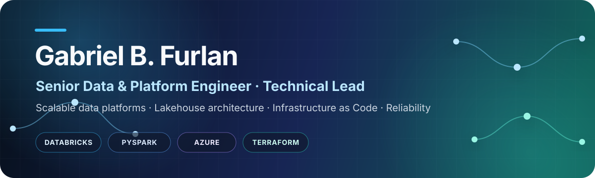

  

  
  
  

  <strong>Vitória, Brazil · Italian / EU citizen</strong> 
  Eligible to work in the European Union · Open to remote and international opportunities

I build and operate data platforms that turn business data into reliable analytics and operational decisions. My work spans banking, fraud prevention, commercial analytics, and global data products, with responsibility for architecture, delivery, performance, and production recovery.

**Core stack:** Databricks · PySpark · Python · SQL · Delta Lake · Azure · Airflow

At AB InBev / BEES, I was the technical owner of a global platform delivering real-time datasets for BI, curated tables for Data Science, and model-generated tasks and planned visits through APIs for field representatives.

## Selected impact

- **AB InBev / BEES:** Platform supporting **22+ countries**, processing **50M+ records/day**, and enabling data products and decisioning models that impacted **100K+ users**. Configuration-driven orchestration and platform optimizations reduced runtime by **~35%**, infrastructure cost by **~20%**, and manual operations by **~60%**.
- **Ambev:** Distributed workflows supporting **200K+ monthly promotion campaigns**. Architecture and performance optimization, in partnership with Databricks, reduced Databricks processing costs by **~70%**.

## Featured engineering projects

These independent projects make my engineering decisions reviewable through code, architecture notes, tests, and operational documentation. They use synthetic or sanitized data and contain no proprietary employer code, production data, credentials, or internal business logic.

### [Customer Engagement Data Platform](https://github.com/gabrafur/customer-engagement-data-platform)

Turns synthetic customer activity into ranked recommendations, with explicit controls for data quality, reruns, historical rebuilding, and simulated delivery.

- **Processing:** Five-task Databricks serverless pipeline using PySpark and Unity Catalog managed Delta tables, with quality checks that stop invalid data before publication.
- **Reliability:** An identical rerun inserted **zero new recommendations**; historical replay stayed isolated from normal output and delivery tables.
- **Evidence:** The documented v0.3.0 run passed **17 independent acceptance checks** against persisted state, tied to the deployed source commit and package.

The public demonstration uses 100 synthetic customers and 380 transactions. It validates processing behavior; production-scale experience is described separately above.

`Python` · `PySpark` · `Spark SQL` · `Databricks` · `Unity Catalog` · `Delta Lake`

[Architecture and trade-offs](https://github.com/gabrafur/customer-engagement-data-platform/blob/main/docs/interview-walkthrough.md)

---

### [Local AI RTX](https://github.com/gabrafur/local-ai-rtx)

Connects engineering tools to local Ollama-compatible models through MCP and a CLI, with controlled task routing and validation before a result is used.

- **Integration:** Python MCP server and CLI using the standard library, deterministic routing, and log extraction anchored to source content.
- **Operation:** Versioned, checksummed releases with atomic activation and recoverable rollback.
- **Boundaries:** Metadata-only telemetry, experimental inference routes disabled by default, and fallback to the primary model when a route is unavailable or rejected.

`Python` · `Node.js` · `MCP` · `Ollama` · `NVIDIA RTX` · `WSL2` · `GitHub Actions`

---

### [My Smart Home](https://github.com/gabrafur/my_smart_home)

A continuously operated home-automation platform used to practice event-driven integration, state recovery, and infrastructure maintenance.

- **Resilience:** Node-RED flows handle duplicate events, stale state, retries, and restart recovery.
- **Operations:** Versioned infrastructure, observability, and backup/restore procedures with verification and rollback.
- **Reproducibility:** Public configuration and synthetic tests are separated from private household state; the demo runs without controlling physical devices.

`Python` · `JavaScript` · `Node-RED` · `MQTT` · `Docker Compose` · `Home Assistant` · `Zigbee2MQTT` · `Matter` · `YAML/Jinja`

[Technical portfolio tour](https://github.com/gabrafur/my_smart_home/blob/main/docs/ENGINEERING_TOUR.md)

## Engineering approach

- **Design for recovery:** Define processing boundaries, stable identities, retry behavior, and reconciliation so reruns and incident recovery have predictable outcomes.
- **Make decisions reusable:** Turn recurring production problems into shared patterns, configuration-driven workflows, and reviewable architecture decisions.
- **Connect engineering to users:** Work with Product, Data Science, BI, and business stakeholders to clarify what data must reach each consumer and when.
- **Develop the team:** Mentor engineers, review code and designs, and align architecture, delivery, and operational responsibilities.

## Professional background

**AB InBev / BEES · Senior Data Engineer / Data Platform Technical Lead · Feb 2025–Sep 2026**

Owned architecture, orchestration, deployment, observability, and incident response for a global data platform. Built partition-scoped Delta `MERGE` and retry strategies, workflow controls that kept snapshots consistent, and idempotent delivery and reconciliation patterns for concurrent country workloads. Integrated Cosmos DB, files, ODBC sources, and Delta tables into batch and streaming pipelines serving BI, Data Science, and operational APIs.

**Ambev · Data Engineer Specialist / Databricks Lakehouse Engineer · Jun 2022–Feb 2025**

Built Azure Databricks solutions for Revenue Management, marketplace prioritization, and promotion optimization. Integrated intraday weather data for **5,000+ Brazilian cities** and external market research into analytical workflows. Worked with Airflow, Azure Data Factory, Unity Catalog, Azure DevOps, RabbitMQ, and Azure Service Bus.

**Santander Brazil · Senior Data Analyst / Data Engineer, Fraud Analytics · Dec 2019–May 2022**

Built ETL and streaming pipelines, fraud-monitoring data structures, and reusable Python tooling. Worked extensively with **Apache Hive and Impala**. Developed systems connecting anomaly detection to operational workflows and supported fraud-prevention initiatives associated with **~80% lower losses within the covered scope**, approximately **US$200M**.

**Itaú Unibanco · Operations Analytics and Workforce Planning · Dec 2016–Dec 2019**

Progressed from intern to planning and performance analyst. Used SQL, SAS, and operational data to improve forecasting, staffing, routing, and service-center availability. Contributed to approximately **US$5M in annual savings** through resource reallocation and a further **US$10M** through improved service-center availability.

## Technologies and tools

**Data platforms and orchestration**

**Languages and development**

**Cloud, infrastructure, and delivery**

**Integration, quality, and observability**

**AI tools and local inference**

-111827?style=flat-square&logo=cursor&logoColor=white)

**Automation and IoT**

## Education and development

- **Postgraduate Specialization in Data Engineering** · Escola Politécnica da USP
- **Bachelor's in Aerospace Engineering** · Universidade Federal do ABC
- **Technical Degree in Electrotechnics** · IFES
- Preparing for the **Databricks Certified Data Engineer Professional** examination.
- Continuing development in **Generative AI, agent engineering, MLOps, and data platform architecture**.
- **Languages:** Portuguese (native) · English (B2 professional) · Spanish (basic)

## Connect

Interested in Senior and Staff opportunities in **Data Engineering and Data Platform Engineering**, with a focus on technical leadership, reliable distributed processing, and global data products.

  

